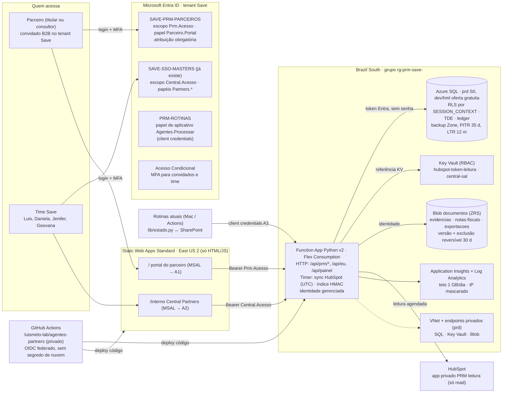

# PRM Save v2 · 04 · Arquitetura e pedido à TI

**Versão:** 1.0 · **Data:** 26/10/2026 · **Área:** TI & Automação (Gerente de TI; Arquiteto de Integrações; Identidade, Segurança e LGPD Técnica; Operação, Custos e Continuidade; Gestão de Incidentes; Revisor Técnico) · **Status:** rascunho para o Luis e para a TI da Save. Nada foi criado na nuvem, nenhum pedido foi enviado.
**Base:** `docs/prm/desenho-prm-save-2026-10-26.md` (8 módulos, 13 tabelas, fases 0 a 4), `docs/prm/engenharia-reversa-prm-2026-10-26.md` (Parte E2, Azure), `central/` (login MSAL, API com 28 testes, esteira e 1ª checagem), `docs/sso-entra/` (plano de 16/10 e roteiro da TI de 19/10), `docs/pedidos-ti-2026-10-23.md`, `.github/workflows/`, `lib/estado.py`.
**IaC:** `docs/prm/v2/infra/main.bicep` com `parametros-dev|hml|prd.exemplo.json`. Só arquivo: não implantado e não compilado (o Mac não tem a CLI do Bicep). A TI roda `what-if` antes de criar.
**Preços:** API pública de preços da Azure (`prices.azure.com/api/retail/prices`, Brazil South, consulta de 26/10/2026, preço de lista em US$, sem impostos nem câmbio). Todo total é **estimativa**.

---

## 0. Resumo em 8 linhas

1. O PRM nasce **em cima do `central/`**: mesmo login MSAL (Authorization Code + PKCE), mesma validação de token (`token.py`) e a mesma regra "o servidor decide" (`permissoes.py`). Muda o seguinte: entram o **banco SQL**, o **parceiro convidado (B2B)** e o **filtro por linha**.
2. A pilha tem 1 Static Web App Standard, 1 Function App Python v2 (Flex Consumption) em Brazil South, 1 Azure SQL, 1 Key Vault, 1 conta Blob de documentos, Application Insights com Log Analytics, e orçamento com alertas. São 3 ambientes, cada um no seu grupo de recursos.
3. **Os 25 convites do SWA não se aplicam.** O login é feito pelo MSAL contra o Entra da Save, e não pelo `/.auth` do SWA. O papel do parceiro sai do banco no 1º acesso (`/api/eu`), o equivalente ao "papel atribuído por função". Não há limite de usuários.
4. O parceiro usa **um registro de aplicativo próprio** (`SAVE-PRM-PARCEIROS`), separado do `SAVE-SSO-MASTERS` interno. Um convidado nunca recebe token que abra a API interna.
5. **Achado de custo:** o SQL serverless sai caro para este uso. Com o banco acordado no horário comercial, custa cerca de US$ 140/mês. Se a sincronização a cada hora o impedir de pausar, passa de US$ 360/mês. O **S0 fixo custa US$ 17,81/mês**, tem SLA e preço previsível. Recomendo S0 em produção e a oferta gratuita em dev e homologação. A decisão é do Luis (§6).
6. Custo estimado: produção de US$ 31 a 54/mês (sem ou com rede privada), homologação de cerca de US$ 10/mês e dev de cerca de US$ 0. Total de **US$ 500 a 780/ano**, acima dos "menos de US$ 500/ano" do desenho, por causa do banco com SLA e da rede privada.
7. Os dados ficam em Brazil South: o backup do SQL fica em zona ou local, e o armazenamento em ZRS ou LRS, **nunca Geo**, porque a região par de Brazil South é South Central US, nos EUA. Só o HTML e o JS do SWA ficam fora (East US 2), sem dado de cliente.
8. Pedido à TI em §5: 9 itens, um responsável e uma data. O primeiro passo é homologação com 1 Master, depois de nomeado o responsável na TI e com o parecer LGPD.

---

## 1. Arquitetura-alvo

### 1.1 Diagrama



### 1.2 Peça por peça

| Peça | Escolha | Por quê | Fonte (consulta 26/10/2026) |
|---|---|---|---|
| Front | **Static Web Apps Standard**, US$ 9/app/mês, região East US 2 | O Standard é o único que liga uma Function App própria (backend vinculado) e aceita autenticação personalizada. O plano Free só tem Functions gerenciadas com gatilho HTTP, sem identidade gerenciada nem Key Vault. A banda inclui 100 GB/mês e o excedente custa US$ 0,20/GB | learn.microsoft.com/azure/static-web-apps/plans · …/functions-bring-your-own (atualizado em 23/01/2026: "requires the Static Web Apps Standard plan") · API de preços |
| Login | **MSAL.js 5.24.0** (já em `central/web/vendor/`), Code + PKCE, `sessionStorage` | Já pronto e testado. Não usa o `/.auth` do SWA. Por isso o limite de 25 usuários convidados por app do SWA não se aplica | `central/web/app.js`; learn.microsoft.com/azure/static-web-apps/quotas |
| Parceiro externo | **Entra B2B** no tenant da Save, convidado com UserType = Guest e senha de uso único por e-mail, ou conta Microsoft dele | Até 50 mil usuários ativos por mês (MAU) são gratuitos. O convidado fica sob o Acesso Condicional da Save. O External ID em tenant externo só se houver cadastro aberto no futuro (o Go-Local não cobre o Brasil) | learn.microsoft.com/entra/external-id/external-identities-pricing (19/06/2026); engenharia reversa E2 |
| Papel do parceiro | O Entra só dá o "portão" (papel `Parceiro.Portal`). O **papel fino** (titular ou consultor, e qual escritório) vem da tabela `usuario_parceiro`, lida pela API pelo `oid` no `/api/eu` | Equivale ao "papel atribuído por função" do SWA, sem depender dele. É ilimitado. Revogar = desativar a linha ou tirar a atribuição no Entra | desenho §3 (`usuario_parceiro.id_entra`) |
| API | **Function App Python v2, Flex Consumption (FC1), Brazil South**, 2 GB por instância, teto de 10 instâncias em produção | É o plano serverless recomendado pela Microsoft. Tem rede virtual, Python 3.10 a 3.14 e gatilho de temporizador. O código atual (`function_app.py` → `central_api/rotas.py`) roda como está | learn.microsoft.com/azure/azure-functions/flex-consumption-plan (30/09/2026) |
| Banco | **Azure SQL**, autenticação **só Entra** (sem usuário e senha de SQL). Produção em **S0** (10 DTU, US$ 0,5855/dia); dev e homologação na **oferta gratuita serverless** | Ver §3. RLS, TDE, ledger e auditoria funcionam em todos os níveis | API de preços; learn.microsoft.com/azure/azure-sql/database/free-offer (21/10/2026) |
| Segredos | **Key Vault** Standard, RBAC, exclusão reversível de 90 dias e proteção contra purga | O app lê o segredo por referência (`@Microsoft.KeyVault(...)`) com a própria identidade. O segredo não fica em arquivo nem no GitHub | API de preços (US$ 0,03 a cada 10 mil operações) |
| Documentos | **Blob** StorageV2, sem chave compartilhada nem acesso público, com versões e exclusão reversível de 30 dias | Guarda a evidência do registro (M2), a NF do parceiro (M4) e as exportações, que expiram em 7 dias. O navegador nunca recebe link SAS: a API lê e entrega | — |
| Sincronização do HubSpot | **Temporizador na mesma Function App**, a cada 2 h, das 10h às 22h UTC (7h às 19h de Brasília), em dias úteis. Token de um app privado **novo**, "PRM leitura", só com escopos de leitura | No Flex, `TZ` e `WEBSITE_TIME_ZONE` não funcionam, por isso o cron fica em UTC. O Logic Apps não traz ganho: o código de leitura já existe em Python (`negocio_ativo.py`, `crm_checagem.py`). Um token separado do usado pelas Actions pode ser revogado sem afetar o resto | flex-consumption-plan ("TZ … not supported") |
| Observabilidade | Application Insights ligado a um Log Analytics, sem chave local, com IP mascarado, teto de 1 GB/dia em produção e retenção de 90 dias | Os primeiros 5 GB/mês por conta de cobrança são gratuitos; depois, US$ 4,60/GB em Brazil South | API de preços |
| Rede (produção) | VNet com sub-rede delegada para a Function e endpoints privados para SQL, Key Vault e Blob | Sem rede privada, o SQL precisa da regra "serviços do Azure", que é ampla. A Function vinculada ao SWA **não pode** ter entrada restrita (exigência do vínculo); só a saída passa pela VNet | functions-bring-your-own ("Required public accessibility") |

### 1.3 Uma API e um front para o portal e para a Central interna
- Um só SWA e uma só Function App: as rotas `/` (portal) e `/interno/` (Central) usam registros de aplicativo diferentes. A API aceita os dois públicos (`aud`), mas **cada rota exige o seu**: `/api/prm/parceiro/*` só aceita `Prm.Acesso`, e `/api/painel`, `/api/prm/save/*` só aceitam `Central.Acesso` com o papel `Partners.*`. Ajuste em `token.py`: a `Config` passa a ter dois públicos e a identidade devolve qual foi usado.
- O Standard aceita até 5 domínios personalizados no mesmo app, então `central-partners.savecompany.com.br` (interno, já sugerido em 19/10) e `parceiros.savecompany.com.br` podem apontar para o mesmo SWA. O nome final do domínio é decisão do Luis (§6).
- **Ponto a testar na homologação:** quando o SWA repassa a chamada à Function vinculada, ele cria um provedor de identidade próprio na Function, chamado "Azure Static Web Apps (Linked)". Precisamos confirmar que o cabeçalho `Authorization: Bearer` do MSAL chega intacto. Se não chegar, o contorno é enviar o token num cabeçalho próprio (`X-Prm-Token`), que a API passa a aceitar. Não verificado; é o 1º teste da homologação.

### 1.4 Ambientes

| | dev | hml (homologação) | prd (produção) |
|---|---|---|---|
| Para quê | Desenvolvimento dos agentes; testes automáticos | Teste da TI e piloto fechado (Luis, Daniela, 1 Master) | Parceiros reais |
| Onde roda o código | Mac (`central/dev_server.py`, porta 4280) e, opcionalmente, um SWA Free | Azure, grupo `rg-prm-save-hml` | Azure, grupo `rg-prm-save-prd` |
| SWA | Free (sem backend vinculado) | Standard | Standard |
| SQL | Oferta gratuita (até 10 bancos gratuitos por assinatura) | Oferta gratuita, "cobrar o excedente", com alerta | S0, backup em zona, PITR de 35 dias, LTR de 12 meses |
| Rede privada | Não | Não (opcional: +US$ 23/mês para ficar igual à produção) | Sim |
| Dados | **Fictícios** (como no protótipo) | Fictícios e 1 Master real com aceite | Reais |
| Registro no Entra | Os mesmos registros, com redirect `localhost` | Redirect do SWA de homologação | Redirect do domínio da Save |
| Quem publica | Agentes, sem aprovação | GitHub Actions, a cada merge em `main` | GitHub Actions por disparo manual do Luis, com a mesma versão que passou na homologação |

### 1.5 CI/CD pelo GitHub Actions
- **Sem segredo de nuvem no GitHub:** o login na Azure é por **OIDC federado**. É um registro `PRM-IMPLANTACAO-GITHUB` com credencial federada para `repo:luismelo-lab/agentes-partners:environment:hml` e `:environment:prd`, e papel **Website Contributor** só na Function do ambiente. A infraestrutura (Bicep) é implantada pela TI, com Owner do grupo; a esteira publica só código.
- **Exceção:** o SWA publica com um token de implantação por ambiente, guardado como segredo de *Environment* do GitHub (`SWA_TOKEN_HML`, `SWA_TOKEN_PRD`). Pode ser revogado no portal a qualquer momento.
- **Workflow novo `prm-deploy.yml`** (a escrever na fase 2, desligado como os demais): checkout → `python -m unittest` em `central/api` → `infra/checar-dados.py` (0 achados) → empacotar `central/api` → `Azure/functions-action` → `Azure/static-web-apps-deploy` com `api_location: ""` (exigência do backend vinculado). O `config.js` é gerado na publicação a partir de *Variables* do ambiente (IDs públicos), e continua fora do repositório.
- **Migrações do banco:** scripts versionados em `central/api/sql/NNN-*.sql`. Na v1, quem aplica é o administrador Entra do SQL (grupo da TI) pelo editor de consultas do portal, primeiro em homologação. A automação vem depois, porque com rede privada o executor do GitHub não alcança o SQL.
- **Migração para a organização da Save no GitHub (T7):** muda o *subject* das credenciais federadas (`repo:<org>/...`), os segredos de Environment e os tokens do SWA. É 1 hora de trabalho da TI, sem mudança de código.
- **Ponto não verificado:** a regra de aprovador obrigatório em *Environments* de repositório privado depende do plano do GitHub. Sem ela, a produção só publica por `workflow_dispatch` disparado pelo Luis, na `main`.

### 1.6 Como o PRM conversa com o que já existe
- **HubSpot:** só leitura, sempre. O registro aprovado entra no HubSpot pela Daniela, pelo fluxo atual (desenho M2).
- **Rotinas (Mac e Actions):** continuam com o estado no SharePoint (`lib/estado.py`). Para ler ou gravar no PRM, usam a API com o papel de aplicativo `Agentes.Processar` (etapa 4 do plano SSO). Não acessam o SQL direto.
- **Índice HMAC de negócios ativos:** passa a ser montado pela própria Function a cada sincronização e gravado numa tabela, com o mesmo `CENTRAL_SAL`, guardado no Key Vault. O índice que viaja pelo SharePoint continua servindo à esteira até o corte.
- **D89 (22/10, SWA Standard e Table Storage):** o SWA Standard se mantém. Para as decisões da Central, proponho trocar o Table Storage pelo **mesmo SQL do PRM**: o S0 não tem custo adicional, a trilha de auditoria fica num só lugar e o filtro por linha também. Isso muda a D89 e é decisão do Luis (§6).

---

## 2. Segurança e LGPD técnica

### 2.1 Autorização por linha (o servidor decide; o banco confere)

**Três camadas, nesta ordem, em toda requisição:**
1. **Token** (`token.py`, já pronto): assinatura por JWKS, `iss`, `aud` do público da rota, `tid` igual ao tenant da Save, validade e escopo. Um convidado B2B recebe token do tenant da Save (o `tid` é o da Save), então a validação atual serve sem mudança.
2. **Papel e escopo de dados** (`permissoes.py`, a estender):

| Quem | Como é identificado | Vê | Não vê |
|---|---|---|---|
| Consultor (parceiro) | `oid` → `usuario_parceiro` com papel `consultor` | Os registros, negócios, demandas e documentos **dele** | Os de outros consultores do escritório; o extrato do escritório, se o termo não der esse acesso a ele |
| Titular (parceiro) | `oid` → `usuario_parceiro` com papel `titular` | Tudo do **escritório** (todos os consultores), o extrato e o nível | Outros escritórios; margem e comissões internas (R12) |
| Save, Gestor | `Partners.Gestor` | Tudo, incluindo "ver como" no servidor | — |
| Save, Masters (Daniela) | `Partners.Masters` | Todos os parceiros: fila de registros, conflitos, demandas e extratos | Decisão de conflito (só o Luis, R15) |
| Save, BDR e Técnica | `Partners.BDR`, `Partners.Tecnica` | Só o que a função pede (indicações e prospecção; negócios em execução) | Extrato e termos |
| Save, Leitura | `Partners.Leitura` | Agregados (M8 sem CNPJ) | Dado de cliente |
| Rotinas | `Agentes.Processar` | Pendências e resultados pela API | Telas de usuário |

3. **Filtro por linha no banco (RLS):** é a segunda trava, se a API errar um filtro. A cada requisição, a API grava o escopo na sessão com `sp_set_session_context ... @read_only = 1`, e uma política de segurança filtra e bloqueia linhas fora do escopo:

```sql
CREATE FUNCTION seg.fn_escopo(@parceiro_id int, @usuario_id int)
RETURNS TABLE WITH SCHEMABINDING AS RETURN
SELECT 1 AS ok WHERE
  CAST(SESSION_CONTEXT(N'escopo') AS varchar(12)) = 'save'
  OR (CAST(SESSION_CONTEXT(N'escopo') AS varchar(12)) = 'titular'
      AND @parceiro_id = CAST(SESSION_CONTEXT(N'parceiro_id') AS int))
  OR (CAST(SESSION_CONTEXT(N'escopo') AS varchar(12)) = 'consultor'
      AND @parceiro_id = CAST(SESSION_CONTEXT(N'parceiro_id') AS int)
      AND @usuario_id = CAST(SESSION_CONTEXT(N'usuario_id') AS int));
-- uma política por tabela com dono: registro_oportunidade, negocio, extrato_linha, demanda, contestacao, documento
CREATE SECURITY POLICY seg.politica_parceiro
  ADD FILTER PREDICATE seg.fn_escopo(parceiro_id, usuario_id) ON dbo.registro_oportunidade,
  ADD BLOCK  PREDICATE seg.fn_escopo(parceiro_id, usuario_id) ON dbo.registro_oportunidade AFTER INSERT
  WITH (STATE = ON);
```
- Sem escopo na sessão, nenhuma linha aparece: se faltar o contexto, a resposta vem vazia em vez de vazar dado.
- **Testes obrigatórios**, no padrão dos 28 atuais: consultor A não vê consultor B; titular X não vê escritório Y; o `deal_id` de outro parceiro na URL devolve 404, e não 403, para não confirmar que o negócio existe; Leitura não recebe CNPJ; token do portal na rota interna dá 401.
- Identificadores na URL são opacos (UUID), não sequenciais, para impedir enumeração.

### 2.2 Proteção contra varredura da carteira (já existe; vira regra do portal)
- A 1ª checagem do `central/` continua igual. Ela vê só o HMAC da raiz do CNPJ e responde com a **mensagem neutra única** para negócio ativo, índice ausente e teto. O motivo real vai só para o log (R25).
- **Tetos por usuário:** 30 consultas por dia, 10 registros por dia e 3 acertos em "já tem negócio" por dia (`CENTRAL_LIMITE_ATIVO`). Os tetos são configurações da Function (§IaC) e podem ser ajustados sem publicar código.
- **Ao passar do teto de acertos:** a API emite o evento `prm_varredura_suspeita`, o alerta de severidade 1 avisa o Luis e a TI em até 15 minutos (alerta já no Bicep), e o usuário fica `suspenso` até a Daniela revisar.
- **Na trilha `acesso_log` entra só o HMAC do CNPJ consultado**, nunca o CNPJ em claro.

### 2.3 Criptografia
- **Em trânsito:** HTTPS com HSTS (já no `staticwebapp.config.json`); TLS 1.2 ou superior em SQL, Storage, Key Vault e Function, forçado no Bicep.
- **Em repouso:** TDE no SQL, criptografia padrão do Storage e Key Vault com chaves gerenciadas pela Microsoft. Chave própria (CMK) não traz ganho proporcional para este volume e fica fora.
- **Coluna sensível:** o contato do decisor (nome, e-mail e telefone do cliente indicado) recebe máscara dinâmica para todos os papéis, exceto Gestor e Masters. Criptografia de coluna (Always Encrypted) foi avaliada e fica fora da v1, porque complica consulta, migração e índice. Reavaliar com o parecer LGPD.
- **Nunca entra no PRM:** CPF, RG, CNH e dado bancário (R24). `lib/protecao.py` passa a rodar também na entrada de texto livre da API, que recusa o envio.

### 2.4 Logs e trilha de auditoria
| Trilha | O que registra | Onde | Retenção proposta |
|---|---|---|---|
| `registro_evento` | Toda mudança de estado: `oid`, papel, ação, antes e depois, data e hora | SQL, **tabela ledger só de inserção** (prova contra adulteração, sem custo extra) | Enquanto houver registro, mais 5 anos (Jurídico confirma) |
| `acesso_log` | Usuário, tela, ação, HMAC do CNPJ consultado, hash do IP | SQL ledger | **6 meses no mínimo** (Marco Civil, Lei 12.965/2014, art. 15) e 12 meses no máximo |
| Telemetria da API | Requisição, status, duração, `oid`, sem CNPJ, sem e-mail e sem corpo | Application Insights / Log Analytics | 90 dias (produção) |
| Auditoria do SQL | Logins (sucesso e falha) e lotes executados | Log Analytics (Bicep) | 90 dias |
| Key Vault e Blob | Quem leu segredo ou documento | Log Analytics (Bicep) | 90 dias |
| Entra | Logins, convites e mudanças de papel | Logs do Entra (TI) | Política da Save |

### 2.5 Cabeçalhos e CSP
A CSP atual do `central/web/staticwebapp.config.json` continua (`script-src 'self'`, `connect-src 'self' https://login.microsoftonline.com`, `frame-ancestors 'none'`), com 3 acréscimos:
- `object-src 'none'`;
- `upgrade-insecure-requests`;
- `Cross-Origin-Opener-Policy: same-origin`.

O fluxo MSAL por redirecionamento, que é o que usamos, funciona com essa política. Nenhuma biblioteca de CDN entra; tudo fica em `vendor/`, com versão fixa. O documento do Blob é entregue pela API, e não por link SAS, então a CSP não precisa liberar o domínio do Storage.

### 2.6 Limite de requisições e abuso
- **Na API:** janela fixa por `oid`, com 60 requisições por minuto, em tabela do SQL. Ao passar do limite, a resposta é 429. O alerta "muitos 401/403/429 por hora" já está no Bicep.
- **Uploads:** até 10 MB; aceitos só PDF, PNG, JPG e XML, conferidos pelos primeiros bytes do arquivo e não pela extensão; o nome é trocado por UUID.
- **Na infraestrutura:** o teto de instâncias da Function (10 em produção) limita custo e abuso. O SWA não tem WAF. Se houver abuso real, entra o Azure Front Door com WAF e regra de limite. O preço não foi verificado nesta consulta; fica como fase 4, se necessário.
- **Opcional em produção:** antivírus no upload pelo Microsoft Defender for Storage. Custa US$ 0,0134/h por conta (cerca de US$ 9,80/mês) mais US$ 0,15 por GB verificado (API de preços). Recomendo ligar quando o upload de NF abrir (fase 3).

### 2.7 Backup e restauração
| Item | Como | RPO / RTO proposto | Teste |
|---|---|---|---|
| SQL | PITR de 35 dias e LTR semanal de 8 semanas e mensal de 12 meses, com cópia na **mesma região** (zona) | RPO ≤ 15 min (log); RTO 4 h | **Trimestral:** restaurar a cópia de produção num banco temporário da homologação, conferir as contagens e apagar. O registro vai para `departamentos/ti/entregas/` |
| Documentos | Versões e exclusão reversível de 30 dias | RPO 0; RTO 1 h | Restaurar 1 arquivo apagado no teste trimestral |
| Segredos | Exclusão reversível de 90 dias e proteção contra purga | — | — |
| Infra | `main.bicep` recria tudo | RTO 1 dia (sem os dados) | `what-if` em toda mudança |
| Código | Git (`main`) | — | — |

Rollback de versão:
- **Function:** nova publicação do pacote anterior (o Flex não tem slots).
- **SWA:** volta pelo histórico de implantações.
- **Banco:** migração com script de volta, e PITR se for necessário.

### 2.8 Resposta a incidente
Severidades S1 a S4 do `depto-ti` (Gestão de Incidentes). Exemplo de S1: vazamento de dado de outro parceiro ou de cliente.
1. **Conter, em até 1 hora:**
   - tirar a atribuição do papel `Parceiro.Portal` (todos os parceiros saem na hora, sem apagar nada);
   - revogar as sessões do convidado no Entra;
   - trocar o token do HubSpot e o `central-sal` no Key Vault;
   - se for preciso, desvincular o backend no SWA.
2. **Preservar:** exportar as consultas do Log Analytics e das tabelas ledger da janela do incidente.
3. **Avaliar** quem foi afetado, que dado vazou e se há risco relevante.
4. **Comunicar:**
   - à ANPD e aos titulares em **3 dias úteis** quando houver risco ou dano relevante (Res. CD/ANPD 15/2024; o prazo é em dobro para agente de pequeno porte);
   - quem decide são o controlador e o encarregado (pendência T4 do Jurídico).
5. **Postmortem** com regra nova e teste automático que impeça a repetição.

### 2.9 Retenção e exclusão a pedido do titular
- **Retenção proposta (o Jurídico decide):**
  - registro recusado ou expirado: 24 meses;
  - registro convertido: vida do contrato mais 5 anos;
  - `acesso_log`: 6 a 12 meses;
  - evidência anexada: 24 meses;
  - exportações: 7 dias (já no ciclo de vida do Blob).
- **Rotina mensal** `prm_retencao` (Function com temporizador) anonimiza o que venceu e registra a contagem.
- **Pedido do titular (LGPD, art. 18):**
  - o pedido entra pela Daniela e pelo encarregado;
  - o script `prm_titular.py` (a escrever) localiza tudo por e-mail ou `oid`, anonimiza o `usuario_parceiro` (nome e e-mail viram hash), apaga os documentos e mantém o que tem obrigação legal (art. 16, I) com o motivo registrado;
  - a TI remove o convidado no Entra.
- **Limite técnico a declarar:** o dado apagado ainda existe nos backups até expirarem (35 dias no PITR; até 12 meses no LTR mensal) e nas versões do Blob (30 dias). Ele não é restaurado para uso.

---

## 3. Custos mensais estimados, limites e alertas

**Fonte:** API pública de preços da Azure, Brazil South (o SWA não tem preço em Brazil South; usei East US 2), consultada em 26/10/2026. Preço de lista em US$, sem impostos nem câmbio. **Tudo é estimativa.** Uso suposto: cerca de 40 usuários, cerca de 50 chamadas por usuário por dia útil e sincronização a cada 2 h em dias úteis.

| Item | Preço unitário (API) | dev | hml | prd |
|---|---|---|---|---|
| Static Web Apps | Standard US$ 9,00/mês; banda até 100 GB inclusa | 0 (Free) | 9,00 | 9,00 |
| Function Flex Consumption | Grátis até 100 mil GB-s e 250 mil execuções/mês; depois US$ 0,000037/GB-s | 0 | 0 | 0 a 3 (estimativa) |
| Azure SQL | S0: US$ 0,5855/dia; oferta gratuita: 100 mil s de vCore/mês | 0 | 0 | **17,81** |
| Blob (documentos e host) | Hot LRS US$ 0,0326/GB; ZRS um pouco mais | ~0,1 | ~0,2 | ~0,5 |
| Key Vault | US$ 0,03 a cada 10 mil operações | ~0 | ~0 | ~0,1 |
| Log Analytics / App Insights | 5 GB/mês grátis por conta de cobrança; depois US$ 4,60/GB | 0 | 0 | 0 a 5 |
| Backup LTR | US$ 0,0475/GB/mês | — | — | ~0,1 |
| Endpoints privados (3) e DNS privado (3) | DNS US$ 0,50/zona (API). Endpoint: **cerca de US$ 7,30/mês cada, valor de lista conhecido, não confirmado na API** | — | — | ~23,40 |
| Login B2B (MAU) | Primeiros 50 mil MAU gratuitos | 0 | 0 | 0 |
| **Total (estimativa)** | | **~US$ 0 a 1** | **~US$ 10** | **US$ 31 sem rede privada · US$ 54 com** |
| Opcionais | Defender for Storage ~US$ 9,80/mês + US$ 0,15/GB; Defender for SQL e Front Door com WAF não verificados | | | |

**Por ano:** de US$ 500 a 780 nos 3 ambientes. Comparando: as licenças de PRM vão de US$ 3 mil a 53 mil/ano (engenharia reversa, Parte E).

**Por que não o SQL serverless em produção:**

| Opção | Conta | US$/mês |
|---|---|---|
| S0 (10 DTU, 250 GB inclusos, SLA) | 0,5855 × 30,4 dias | **17,81** |
| Serverless GP 1 vCore, mínimo 0,5, pausa após 60 min, acordado das 7h às 19h em dias úteis | (12 h + 1 h de pausa) × 22 dias × 0,5 vCore × US$ 0,99134/h + 10 GB × US$ 0,2185 | ~144 |
| Serverless sem pausa (a sincronização a cada hora, 24×7, impede a pausa) | 730 h × 0,5 × 0,99134 | ~362 |
| Oferta gratuita com "cobrar o excedente" | Os 100 mil s (27,8 h de vCore) acabam em cerca de 5 dias úteis; depois, o preço do serverless | ~116, **sem SLA** |

No uso do PRM (pouca carga o dia inteiro), o serverless cobra o mínimo de 0,5 vCore enquanto está acordado. O S0 sai cerca de 8 vezes mais barato, com SLA e preço fixo. O serverless só compensaria com uso raro e em rajadas.

**Limites e alertas (já no `main.bicep`):**
- **Orçamento por grupo de recursos** (na moeda da assinatura): dev 10, hml 25, prd 90. Avisa em 50%, 80% e 100% do real e em 100% do previsto, por e-mail ao Luis e ao responsável na TI.
- **Oferta gratuita do SQL** (dev e hml): alerta quando restarem menos de 10 mil s de vCore; ao esgotar, "cobrar o excedente", porque o portal não pode parar no dia 25.
- **Log Analytics:** teto diário de 1 GB (prd) ou 0,2 GB (dev e hml), com o alerta de falhas acima de 10 em 15 minutos.
- **Function:** teto de 10 instâncias em produção, 3 em hml e 2 em dev.
- **SWA:** 100 GB de banda inclusos. Com 40 usuários, o uso fica muito abaixo disso.
- **HubSpot:** a sincronização faz leitura em lote, a cada 2 h, só com as propriedades usadas. O limite de chamadas do app privado (por segundo e por dia) depende da assinatura do HubSpot: **não verificado nesta consulta**. Quem confirma é o dono do CRM.

---

## 4. Plano de implantação

| # | Passo | Save TI faz | Nós entregamos (agentes) | Pronto quando |
|---|---|---|---|---|
| 0 | Decisões e pareceres | Nomeia o responsável e a data (pendência desde 30/09) | Este documento e o Bicep | O Luis aprova as decisões de §6; o Jurídico dá o parecer LGPD (dado de cliente no SQL) |
| 1 | Assinatura e grupos | Cria a assinatura no tenant da Save (ou usa uma existente), registra os provedores `Microsoft.Web`, `Microsoft.Sql`, `Microsoft.App` (exigido pela VNet do Flex), `Microsoft.KeyVault` e `Microsoft.Insights`, e cria `rg-prm-save-hml` e `rg-prm-save-prd` | — | A TI dá ao Luis o papel Reader nos grupos |
| 2 | Grupos do Entra | Cria `PRM-SQL-Admins` (TI), `PRM-Parceiros-Piloto` e `PRM-Time-Save` | Lista de quem entra em cada grupo | Object IDs informados (não são segredo) |
| 3 | Infraestrutura da homologação | Roda `what-if` e `create` com `parametros-hml.exemplo.json` preenchido | `main.bicep` e ajuste de qualquer erro do `what-if` | Recursos criados; saídas copiadas para o Luis |
| 4 | Registros de aplicativo | **`SAVE-PRM-PARCEIROS`:** single-tenant, plataforma SPA, redirects de hml e prd, escopo `Prm.Acesso` (só administrador consente), papel `Parceiro.Portal`, **atribuição obrigatória = Sim**, token v2. **`SAVE-SSO-MASTERS`:** adiciona os redirects de hml e prd (itens pendentes de 19/10). **`PRM-ROTINAS`:** papel de aplicativo `Agentes.Processar`, com certificado no Key Vault. **`PRM-IMPLANTACAO-GITHUB`:** credencial federada para `hml` e `prd` e Website Contributor na Function | Roteiro clique a clique, no estilo de `orientacoes-ti-2026-10-19.md` | Login do Luis na homologação devolve o papel certo |
| 5 | Acesso Condicional | Política "PRM convidados": MFA obrigatório para o app `SAVE-PRM-PARCEIROS` e para convidados; sessão de 12 h; bloqueio de país fora do Brasil, se for política da Save. Configura acesso entre tenants para confiar no MFA do tenant do parceiro, quando houver | — | Teste negativo: convidado sem MFA não entra |
| 6 | Segredos | Cria o app privado "PRM leitura" no HubSpot (só escopos de leitura de negócios, empresas e responsáveis) com o dono do CRM; grava `hubspot-token-leitura` e `central-sal` no Key Vault pelo portal. **Nunca por e-mail ou chat** | Lista exata de escopos e propriedades lidas | `/api/saude` mostra "segredos resolvidos" sem exibir valor |
| 7 | Banco | Como administrador Entra, roda o `CREATE USER` da saída `proximoPassoSql` e os scripts `sql/001…` (esquema, RLS, ledger) | Scripts SQL versionados, com testes de RLS | Os testes de escopo (§2.1) passam contra a homologação |
| 8 | Código e esteira | Cria os *Environments* `hml` e `prd` no GitHub, com o token do SWA e as variáveis públicas | Tabelas e rotas do PRM em `central/api`, telas em `central/web`, `prm-deploy.yml` desligado até o ok | Publicação automática na homologação a cada merge |
| 9 | Convites B2B (piloto) | Convida o titular e os consultores de 1 Master. É manual pelo portal, porque são poucos; não há limite de 25. Atribui o grupo `PRM-Parceiros-Piloto` ao papel `Parceiro.Portal` | Cadastro em `usuario_parceiro` pela Daniela, na tela da Save | O Master entra, vê só os negócios dele e registra 1 indicação de teste |
| 10 | Revisão de segurança | Revisa o checklist: OWASP ASVS nível 1, testes de §2.1, CSP, logs e alertas disparados de propósito | Relatório de testes, simulação de varredura e evidências | A TI assina a revisão |
| 11 | Produção | Roda o Bicep com `parametros-prd`, cria o CNAME `parceiros.savecompany.com.br` (ou o nome decidido) apontando para o SWA e valida o domínio | Publicação da mesma versão da homologação, por disparo do Luis | 2º Master entra; teste trimestral de restauração agendado |
| 12 | Escala (fase 4) | Convites em lote. Se passar de cerca de 50 por mês, automatiza pelo Graph (`POST /invitations`) num app com o papel Guest Inviter, a pedido | Painel de adoção (M8) | — |

**Cronograma indicativo**, estimativa sem fonte externa, depois de nomeado o responsável na TI:
- passos 1 a 5: 1 semana de TI;
- passos 6 a 10: 3 a 5 semanas;
- produção com 2 Masters: 6 a 8 semanas.

---

## 5. Mensagem pronta para a TI da Save (rascunho, nada enviado)

> **Assunto:** Portal de parceiros (PRM) · pedido único de recursos Azure e Entra · Área Partners
>
> Olá, [nome do responsável na TI],
>
> A Área Partners vai abrir um portal para os parceiros registrarem indicações e acompanharem os próprios negócios. Ele é construído sobre a Central Partners (SAVE-SSO-MASTERS), cujas etapas 1 e 2 estão prontas desde 19/10. Todo o dado fica no tenant da Save, em Brazil South. O HubSpot segue só leitura.
>
> **O que pedimos** (roteiro detalhado e IaC em Bicep no anexo; nada é implantado por nós):
>
> | # | Item | Escopo mínimo |
> |---|---|---|
> | 1 | Assinatura (ou uma existente) e dois grupos de recursos: `rg-prm-save-hml` e `rg-prm-save-prd` | Reader para o Luis |
> | 2 | Rodar `main.bicep` (what-if, depois create) em homologação | Static Web Apps Standard, Function App Flex em Brazil South, Azure SQL (só Entra), Key Vault, Blob e App Insights |
> | 3 | Registro novo **SAVE-PRM-PARCEIROS** (SPA, escopo `Prm.Acesso`, papel `Parceiro.Portal`, atribuição obrigatória) e redirects novos no SAVE-SSO-MASTERS | Single-tenant, sem segredo |
> | 4 | Registro **PRM-ROTINAS** (papel de aplicativo `Agentes.Processar`, certificado no Key Vault) e **PRM-IMPLANTACAO-GITHUB** (credencial federada OIDC, Website Contributor só na Function) | Sem segredo no GitHub |
> | 5 | Acesso Condicional: MFA obrigatório para convidados e para o app do portal | Política da Save |
> | 6 | Com o dono do CRM: app privado "PRM leitura" no HubSpot; token gravado no Key Vault pela TI | Só escopos de leitura |
> | 7 | Grupo administrador do SQL e criação do usuário da Function no banco (1 comando, que vem pronto) | — |
> | 8 | Convites B2B do piloto: titular e consultores de 1 Master (cerca de 5 pessoas) | Grupo `PRM-Parceiros-Piloto` |
> | 9 | Revisão de segurança antes do 1º parceiro; depois, a produção e o CNAME `parceiros.savecompany.com.br` | — |
>
> **Custo estimado:** cerca de US$ 10/mês em homologação e US$ 31 a 54/mês em produção (preço de lista em Brazil South, 26/10/2026). Há orçamento com alerta em 50%, 80% e 100% no próprio Bicep.
>
> **Segurança:**
> - login só pelo Entra da Save, com MFA;
> - parceiro e time em registros separados;
> - o banco filtra por linha (cada parceiro vê só o que é dele);
> - segredos só no Key Vault;
> - backup na mesma região;
> - logs de acesso e alerta de varredura.
>
> Tudo pode ser desligado na hora: basta tirar a atribuição do papel `Parceiro.Portal`.
>
> **O que precisamos de volta:**
> 1. Nome do responsável e data para os itens 1 a 5 (homologação).
> 2. Os IDs públicos: tenant, client IDs e object IDs dos grupos. Os segredos ficam no Key Vault e nunca circulam por e-mail ou chat.
> 3. Um teste conjunto de 30 minutos na homologação: login do Luis, login de 1 convidado e uma tentativa negativa (convidado sem papel).
>
> Obrigado,
> Luis Melo · Área Partners

---

## 6. Riscos técnicos e decisões do Luis

### 6.1 Riscos técnicos
| # | Risco | Prob. | Impacto | Mitigação |
|---|---|---|---|---|
| R1 | A TI não nomeia responsável (sem resposta desde 30/09, 13/10 e 23/10) | Alta | Fase 2 parada | A fase 1 segue no painel; a mensagem de §5 pede nome e data; escalar à diretoria depois de 10 dias úteis |
| R2 | O SWA troca o `Authorization` ao repassar à Function vinculada | Média | Login do portal falha | 1º teste da homologação; contorno com o cabeçalho `X-Prm-Token` (§1.3) |
| R3 | Erro no filtro de escopo expõe dado de outro parceiro | Baixa | Alto (incidente LGPD) | 3 camadas (token, papel e RLS), testes negativos obrigatórios, IDs opacos, 404 para o que não é seu |
| R4 | Varredura da carteira pelo registro | Média | Alto | Mensagem neutra, tetos, suspensão automática, alerta S1 (§2.2) |
| R5 | A produção diverge da homologação na rede privada | Média | Erro só em produção | Ligar a rede privada também na hml (+US$ 23/mês) ou testar a produção com o 1º Master antes do 2º |
| R6 | Manutenção depende dos agentes, sem dono técnico humano | Alta | Correção lenta | Código com testes, IaC e runbook; dono técnico na TI para incidentes; reavaliar compra acima de cerca de 100 parceiros ativos |
| R7 | Limite de chamadas do HubSpot ou mudança de propriedade quebra a sincronização | Média | Status do parceiro desatualizado | Leitura em lote a cada 2 h, alerta de falha, data da última atualização na tela, sem promessa de tempo real |
| R8 | Plano do GitHub sem aprovador obrigatório em repositório privado | Média | Publicação sem revisão | Produção só por disparo manual do Luis; migração para a org da Save (T7) |
| R9 | Convidado sem MFA, ou conta pessoal do parceiro comprometida | Média | Acesso indevido | Acesso Condicional com MFA, sessão de 12 h, revisão trimestral de acessos (Entra Access Reviews, se a licença permitir) |
| R10 | Backup guarda dado apagado a pedido do titular | Certa | Baixo, se declarado | Declarar no aviso de privacidade (§2.9); LTR de 12 meses é decisão |
| R11 | Câmbio e imposto mudam o custo em reais | Certa | Baixo | Orçamento na moeda da assinatura com alerta; revisão trimestral |
| R12 | Bicep não compilado aqui (sem CLI no Mac) | Média | Erro na 1ª implantação | A TI roda `what-if` e nós corrigimos antes de qualquer `create` |

### 6.2 Decisões do Luis (alçada: orçamento, nova fonte de dado pessoal, regra)
1. **Orçamento de nuvem do PRM:** cerca de US$ 10/mês na homologação e US$ 31 a 54/mês na produção, quem paga e em que centro de custo (pendência T6). **Recomendação:** aprovar até US$ 90/mês na produção e US$ 25 na homologação, com os alertas do Bicep.
2. **Banco de produção: S0 ou serverless.** **Recomendação:** S0 (US$ 17,81/mês, SLA, preço fixo), oferta gratuita em dev e hml. O serverless pedido no desenho custa de US$ 116 a 362/mês para este padrão de uso.
3. **Rede privada em produção** (+cerca de US$ 23/mês). **Recomendação:** sim, porque o banco guarda CNPJ e contato de cliente indicado. Na homologação é opcional.
4. **Guarda de CNPJ e contato do decisor no Azure SQL**, uma exceção à regra "dado de cliente fica no Mac" (já é a decisão 5 do desenho). **Recomendação:** aprovar, condicionado ao parecer LGPD, com as retenções de §2.9.
5. **Mudar a D89:** decisões da Central no mesmo SQL do PRM, no lugar do Table Storage. **Recomendação:** sim, para ter uma trilha e um filtro só, sem custo extra.
6. **Domínio:** `parceiros.savecompany.com.br` ou `partners.savecompany.com.br`, mais `central-partners.savecompany.com.br` para o time, no mesmo SWA. **Recomendação:** `parceiros.` (português, como as telas) e `central-partners.` para o time.
7. **Retenção dos backups mensais (LTR de 12 meses)** contra o prazo de exclusão a pedido do titular. **Recomendação:** 12 meses, declarados no aviso de privacidade; o Jurídico confirma.
8. **Quem entra no piloto da homologação:** 1 Master com consultores, com aceite do termo de uso do portal. O desenho prevê 2 Masters na fase 2. **Recomendação:** 1 Master na homologação e o 2º só em produção.

---

## 7. Entrega em 3 blocos

**1. O que você pediu**
- Arquitetura-alvo com diagrama (§1).
- Segurança e LGPD técnica: filtro por linha em 3 camadas com exemplo de RLS, criptografia, trilhas, CSP, limites, varredura, backup, incidente e retenção (§2).
- Custos por ambiente com preço da API oficial de 26/10/2026 e alertas (§3).
- Plano em 12 passos, separando TI e agentes (§4).
- Mensagem à TI pronta (§5).
- Riscos e 8 decisões (§6).
- IaC em `docs/prm/v2/infra/main.bicep` com 3 arquivos de parâmetros de exemplo, sem segredo.

**2. O que você também precisa**
- O limite de 25 convites não vale para o nosso login (MSAL), e o papel por função sai do banco: não há teto de parceiros.
- O SQL serverless é a parte cara da pilha para este uso; o S0 resolve com SLA.
- Backup e armazenamento "Geo" mandariam dado para os EUA; o Bicep força a mesma região.
- Pendências de código (fase 2, nossas):
  - dois públicos em `token.py`;
  - escopo de parceiro em `permissoes.py`;
  - tabelas e RLS;
  - rotas `/api/prm/*`;
  - limite por usuário;
  - aceitar o `X-Prm-Token`, se o teste R2 pedir;
  - `prm_titular.py`;
  - `prm-deploy.yml`.
- Sugestão para o inventário de agentes (`departamentos/ti/inventario-agentes.md`, Governança de IA): registrar a Function de sincronização e a de retenção como rotinas novas, quando forem criadas.

**3. O que falta e quem fornece**
| Falta | Quem |
|---|---|
| Responsável e data na TI; assinatura, registros, Acesso Condicional, convites | TI da Save |
| Parecer LGPD (dado de cliente no SQL), retenções, aviso de privacidade e termo de uso do portal | Jurídico |
| Controlador e encarregado para a comunicação de incidente (T4) | Jurídico e Luis |
| App privado "PRM leitura" no HubSpot e limite de chamadas da conta | Dono do CRM |
| Orçamento e decisões de §6.2 | Luis |
| Plano do GitHub e migração para a org da Save (T7) | TI e Luis |

---

## 8. Revisão

**Registro `revisao` (protocolo do gerente):**
- Rodada 1 do Revisor Técnico:
  - (a) nenhum segredo, token, ID real ou URL de cliente no texto nem no Bicep; os parâmetros só têm marcadores;
  - (b) toda afirmação de produto tem fonte com data, ou está marcada como "não verificado";
  - (c) menor privilégio: a Function só tem Blob Owner no próprio pacote, Blob Contributor nos documentos, Secrets User no Key Vault e Metrics Publisher; o GitHub só tem Website Contributor;
  - (d) correção: os 25 convites do SWA citados no desenho não se aplicam ao login MSAL; registrado em §0 e §1.2.
- Rodada 2: o custo do serverless foi recalculado com o preço de Brazil South (US$ 0,99134 por vCore-hora), que é cerca de 1,9 vez o dos EUA; a recomendação mudou para S0.
- Não executado: compilação do Bicep (sem CLI) e preço do endpoint privado na API.

**Fontes (consulta de 26/10/2026):**
- API de preços: `prices.azure.com/api/retail/prices`, filtros por `armRegionName eq 'brazilsouth'` (SQL Standard/Basic e Serverless Gen5, Flex Consumption, Log Analytics, Key Vault, Block Blob v2, LTR Backup, Defender for Storage) e Static Web Apps (East US 2), e Azure DNS.
- Microsoft Learn:
  - `azure-functions/flex-consumption-plan` (atualizado em 30/09/2026);
  - `static-web-apps/functions-bring-your-own` (23/01/2026);
  - `static-web-apps/plans` e `/quotas` (via engenharia reversa, 28 e 30/09/2026);
  - `entra/external-id/external-identities-pricing` (19/06/2026);
  - `azure-sql/database/free-offer` (21/10/2026).
- Normas: Lei 12.965/2014 (Marco Civil), art. 15; Lei 13.709/2018 (LGPD), arts. 16 e 18; Res. CD/ANPD 15/2024 (comunicação de incidente).
